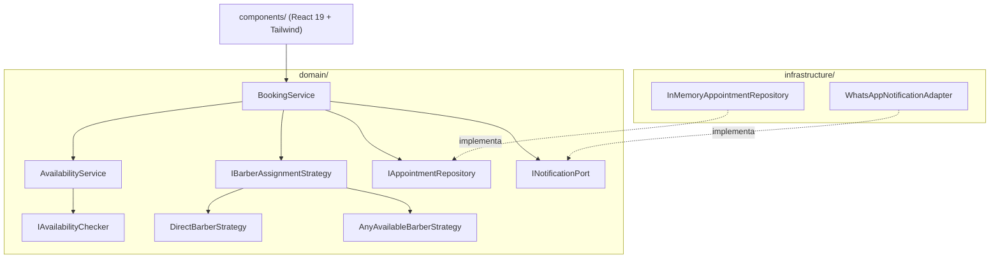
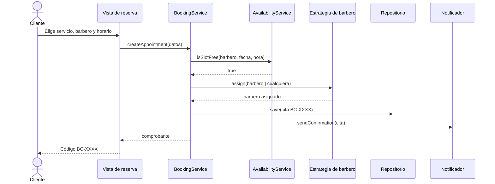
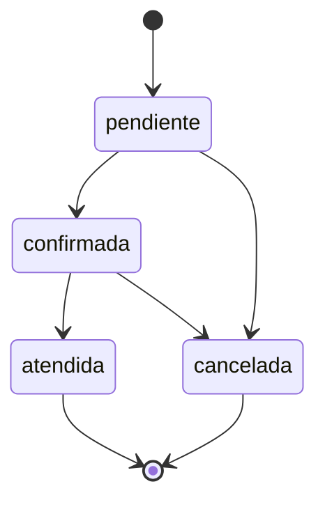

# Arquitectura — Blade & Co

El sistema separa la interfaz (React) de la lógica de negocio (dominio orientado a objetos), siguiendo SOLID y el Modelo C4.

## Capas y dependencias

**Regla clave:** las flechas del dominio apuntan a abstracciones. La infraestructura implementa esas abstracciones (Inversión de Dependencias).

## Flujo de una reserva

## Ciclo de vida de una cita

## Cómo extender el sistema

| Necesidad | Qué hacer |
| :--- | :--- |
| Nueva política de asignación de barberos | Implementar `IBarberAssignmentStrategy` |
| Cambiar la base de datos | Crear un repositorio que implemente `IAppointmentRepository` |
| Cambiar canal de notificación (SMS, correo) | Implementar `INotificationPort` |
| Nuevo rol de personal | Extender `StaffMemberBase` respetando LSP |
